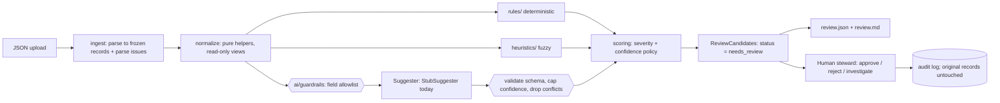

# Architecture

**Boundaries.** The dependency direction is `cli → pipeline → (rules, heuristics, ai) → normalize, models, scoring`. `rules/` never imports `ai/` or `heuristics/`, so the deterministic layer can be tested and trusted on its own. The AI path (dashed in spirit) is a *Should*. If it is absent or fails, the pipeline still produces every rule and heuristic finding.

**Status:** the audit-log step is implemented as `python -m dq apply-decisions` (`dq/review.py`). row gating, a contact-detail screen and a delimited prompt builder (`dq/ai/guardrails.py`), an offline eval gate for suggesters (`dq/ai/evaluate.py`, `python -m dq eval-suggester`) runs in pytest. `dq/ai/` is implemented with an offline `StubSuggester` and the guardrails below; it runs only when the CLI is given `--suggest`. No real provider is wired in.

## Data flow
1. **Ingest** (`dq/ingest.py`) loads the file. An unreadable file, invalid JSON or a non-array top level raises a clean error → CLI exit 2. Each element becomes a frozen `ParsedRecord`, which keeps both raw values (for evidence) and normalized values. A non-object element becomes a `parse_issue`, and R-001 later turns it into a candidate. Ingest never raises on a bad *row*.
2. **Normalize** (`dq/normalize.py`) holds pure helpers: the blank → None rule, trim, canonical MPN (`6205-ZZ`, `6205 zz` → `6205ZZ`), UoM alias lookup, tokenise. These are used for matching only and are never presented as a "new value".
3. **Checks.** Each one is `check(records, cfg) -> list[ReviewCandidate]`, one module per check, pure and deterministic. A check reports *what* it saw (issue type, explanation, evidence, suggested action, related ids).
4. **Scoring** (`dq/scoring.py`) is the single place where severity and confidence are assigned, from `config/rules.json`.
5. **Pipeline** (`dq/pipeline.py`) runs all checks over a tuple of frozen records, collects candidates, sorts them stably (severity desc, item_id, rule_id, row_index) and builds the summary.
6. **Report** (`dq/report.py`) emits the JSON contract and a short markdown summary for the steward. Candidate language only.
7. **Human.** The steward approves, rejects or investigates. Decisions would go to an append-only audit log (Could), and the source records are never touched.

## Where a real LLM would plug in (and its safeguards)
`dq/ai/` defines `Suggester` as a `Protocol`: `suggest(fields: AllowlistedFields) -> SuggestionPayload | None`. Today `StubSuggester` is rule-based and deterministic. A real `AnthropicSuggester` would implement the same Protocol:

| Stage | Safeguard |
|---|---|
| Before sending | **Field allowlist**: only `item_description`, `manufacturer`, `category`, `unit_of_measure`. Never `source_system` internals, prices, user names or free-text notes. Record text is wrapped as delimited **data**, never concatenated into instructions (prompt-injection defence). |
| Calling | Timeouts, bounded retries with backoff, per-call cost/latency logging, a kill switch (config flag) that falls back to the stub, and no call when the record already failed R-001. |
| After receiving | Parse into a strict Pydantic model (`extra="forbid"`), require an explanation, **clamp confidence to 0.6**, drop any suggestion that contradicts a deterministic rule (e.g. suggesting a UoM outside the allowlist). On any failure → no candidate, log it. |
| Output | Always `source="ai_assisted_candidate"`, `status="needs_review"`, `rule_id="A-001"` plus a model/prompt version in `rule_version`. Never auto-applied. |
| Quality over time | An offline **eval set** of steward-labelled records, run in CI on prompt/model changes. Track the acceptance rate of AI candidates from the audit log and demote the AI if precision drops. |

## Why each check is a rule, a heuristic, or AI
| Check | Layer | Reason |
|---|---|---|
| R-001 incomplete / malformed | Rule | Presence and type are decidable by logic. Confidence 1.0. |
| R-002 missing MPN with manufacturer | Rule | A pure field-presence predicate. |
| R-003 duplicate item_id | Rule | Exact key equality. Conflicting vs identical is decidable. |
| R-004 UoM allowlist / alias | Rule | Membership in a governed list. Aliases come from a config table, not a guess. |
| H-001 vague description | Heuristic | "Vague" is a judgement. Token counts and generic-noun lists approximate it, so confidence is < 1. |
| H-002 potential duplicate | Heuristic | Equal canonical MPN + manufacturer strongly suggests the same part, but kits and revisions exist, so a human confirms. |
| H-003 category mismatch | Heuristic | Keyword → category is a signal, not a fact (e.g. a "motor bearing" is still mechanical). |
| A-001 normalized description | AI (stub) | Rewriting free text needs language understanding. It is the least trustworthy layer, so it gets the lowest confidence cap and suggestion only. |

**Rule of thumb:** if two stewards would always agree given the data → rule. If they'd usually agree and a simple, explainable signal exists → heuristic. If it needs language generation or world knowledge → AI, capped and reviewed.
