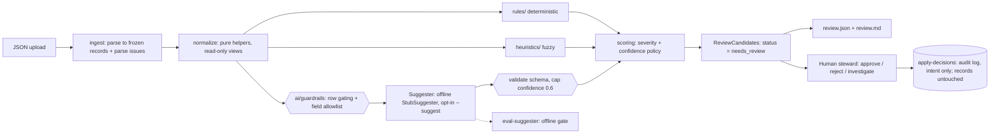

# Architecture

**Boundaries.** The dependency direction is `cli → pipeline → (rules, heuristics, ai) → normalize, models, scoring`. `rules/` and `heuristics/` never import `ai/` (a test enforces it), so the deterministic layers can be tested and trusted on their own. The AI path is opt-in (`--suggest`); if it is absent or fails, the pipeline still produces every rule and heuristic finding.

## What is built and what is design only
| Piece | Status |
|---|---|
| Ingest, normalize, seven checks (R-001 to R-004, H-001 to H-003), scoring, pipeline, JSON + markdown report, CLI | Built |
| `Suggester` Protocol, `AllowlistedFields`, strict response schema, confidence cap, offline `StubSuggester`, A-001 (`dq/ai/`) | Built, opt-in |
| Row gating (rows failing R-001 or carrying email, URL or international phone text are never sent) and `build_prompt` (escaped JSON data block) | Built and tested; `build_prompt` is not used by the offline stub, it is the seam for a real provider |
| Offline eval gate for suggesters (`dq/ai/evaluate.py`, `python -m dq eval-suggester`, 12 cases, runs in pytest) | Built; cases are not steward-labelled |
| Audit log (`python -m dq apply-decisions`, `dq/review.py`) | Built; records intent only |
| Real provider (`AnthropicSuggester`), timeouts, retries, kill switch, cost and latency logging | **Design only** |
| Drop a suggestion that contradicts a deterministic rule | **Design only** (not implemented) |
| Model and prompt version recorded in `rule_version` for AI findings | **Design only** |
| Steward-labelled eval set, acceptance-rate tracking from the audit log | **Design only** |

## Data flow
1. **Ingest** (`dq/ingest.py`) loads the file. An unreadable file, invalid or deeply nested JSON, or a non-array top level raises a clean error → CLI exit 2. Each element becomes a frozen `ParsedRecord`, which keeps both raw values (for evidence) and normalized values. A non-object element, or a field of an unsupported type, becomes a `parse_issue`, and R-001 turns it into a candidate. Ingest never raises on a bad *row*.
2. **Normalize** (`dq/normalize.py`) holds pure helpers: the blank → None rule, trim, canonical MPN (`6205-ZZ`, `6205 zz` → `6205ZZ`), tokenise. These are used for matching only and are never presented as a "new value". UoM aliases are looked up from config in R-004.
3. **Checks.** Each one is `check(records, cfg) -> list[ReviewCandidate]`, one module per check, pure and deterministic. A check reports *what* it saw (issue type, explanation, evidence, suggested action, related ids).
4. **Scoring** (`dq/scoring.py`) is the single place where severity and confidence are assigned, from `config/rules.json`. An AI-supplied confidence can only lower the policy value.
5. **Pipeline** (`dq/pipeline.py`) runs all checks over a tuple of frozen records, optionally the AI layer, collects candidates, sorts them stably (severity desc, item_id with nulls last, rule_id, row_index) and builds the summary.
6. **Report** (`dq/report.py`) emits the JSON contract and a short markdown summary for the steward. Candidate language only.
7. **Human.** The steward approves, rejects or investigates. `apply-decisions` writes those decisions to an append-only audit log; the source records are never touched.

## Where a real LLM would plug in (and its safeguards)
`dq/ai/` defines `Suggester` as a `Protocol`: `suggest(fields: AllowlistedFields) -> object`. The return type is `object` on purpose: provider output is untrusted until the guardrails validate it. Today `StubSuggester` is rule-based and deterministic. A real `AnthropicSuggester` would implement the same Protocol. Status in brackets.

| Stage | Safeguard |
|---|---|
| Before sending | **Field allowlist**: only `item_description`, `manufacturer`, `category`, `unit_of_measure` [built]. Never `source_system` internals, prices, user names or free-text notes [built]. Only complete, well-formed rows without contact details [built]. Record text is JSON-encoded inside a marked data block with a system line calling it untrusted, never concatenated into instructions (prompt-injection defence) [`build_prompt` built and tested, unused by the stub]. |
| Calling | Timeouts, bounded retries with backoff, per-call cost/latency logging, a kill switch (config flag) that falls back to the stub [design only]. A provider exception already yields no candidate and no crash [built]. |
| After receiving | Parse into a strict Pydantic model (`extra="forbid"`), require an explanation, **clamp confidence to 0.6**, drop text identical to the original; on any failure → no candidate, logged [built]. Dropping a suggestion that contradicts a deterministic rule (e.g. a UoM outside the allowlist) [design only]. |
| Output | Always `source="ai_assisted_candidate"`, `status="needs_review"`, `rule_id="A-001"`, never auto-applied [built]. Model and prompt version in `rule_version` [design only]. |
| Quality over time | An offline eval gate with adversarial cases, run in pytest on prompt, model or abbreviation changes [built; 12 cases written by the developer]. A steward-labelled set and acceptance-rate tracking from the audit log, demoting the AI if precision drops [design only]. |

## Why each check is a rule, a heuristic, or AI
| Check | Layer | Reason |
|---|---|---|
| R-001 incomplete / malformed | Rule | Presence and type are decidable by logic. Confidence 1.0. |
| R-002 missing MPN with manufacturer | Rule | A pure field-presence predicate. |
| R-003 duplicate item_id | Rule | Exact key equality. Conflicting vs identical is decidable. |
| R-004 UoM allowlist / alias | Rule | Membership in a governed list. Aliases come from a config table, not a guess. |
| H-001 vague description | Heuristic | "Vague" is a judgement. Token counts and generic-noun lists approximate it, so confidence is < 1. |
| H-002 potential duplicate | Heuristic | Equal canonical MPN + manufacturer strongly suggests the same part, but kits and revisions exist, so a human confirms. |
| H-003 category mismatch | Heuristic | Keyword → category is a signal, not a fact (e.g. a "motor bearing" is still mechanical). |
| A-001 normalized description | AI (offline stub) | Rewriting free text needs language understanding. It is the least trustworthy layer, so it gets the lowest confidence cap and suggestion only. |

**Rule of thumb:** if two stewards would always agree given the data → rule. If they'd usually agree and a simple, explainable signal exists → heuristic. If it needs language generation or world knowledge → AI, capped and reviewed. A test (`tests/properties/test_layers.py`) checks that each finding's `source` matches the layer that produced it.
